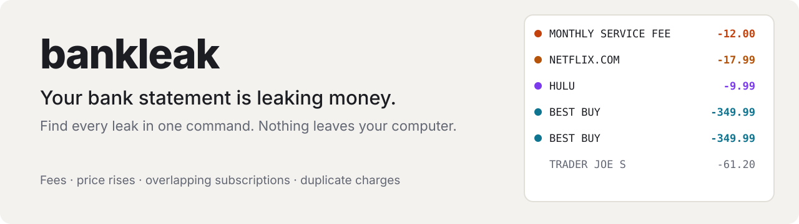
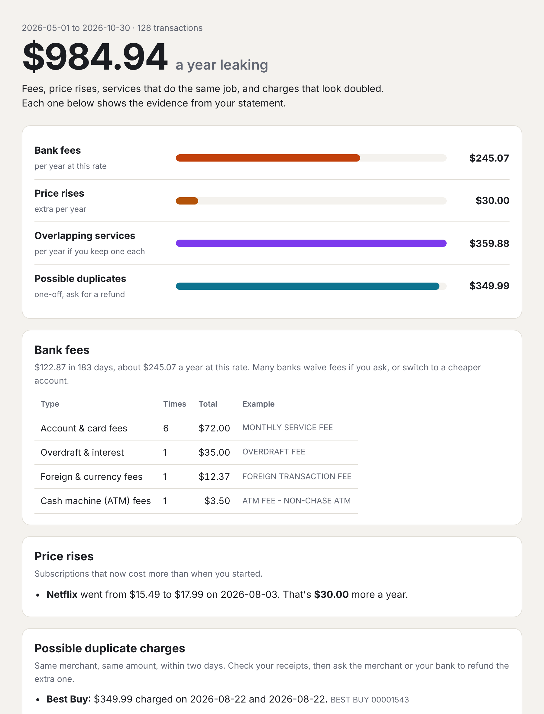

<div align="center">

<picture>
  <source media="(prefers-color-scheme: dark)" srcset="docs/banner-dark.svg">
  
</picture>

<br>

[](https://github.com/mohamedsaidyekhlef-png/bankleak/actions/workflows/ci.yml)
[](LICENSE)


**[Quick start](#quick-start) · [What it finds](#what-it-finds) · [Your bank](#works-with-your-bank) · [Agent skill](#use-it-with-an-ai-agent) · [Privacy](#privacy)**

</div>

---

Banks don't send you a bill for their fees, and services don't email you when the price goes up. Money leaks a few euros or dirhams at a time:

- a monthly account fee
- a foreign-currency charge on every online purchase
- a streaming service that quietly went up 15%
- two services that do the same job
- an annual renewal you forgot
- a card payment that went through twice

**bankleak reads your statement and finds every one, with the line it came from.** It runs entirely on your computer: no account, no upload, no bank login, no network requests.

```bash
npx github:mohamedsaidyekhlef-png/bankleak statement.csv --html report.html
```

<div align="center">

</div>

## Quick start

1. **Download your statement** as CSV, OFX or QFX from your bank's website. Look for "Export", "Download transactions" or "Télécharger les opérations". Several months find more.
2. **Run bankleak:**

```bash
npx github:mohamedsaidyekhlef-png/bankleak statement.csv
npx github:mohamedsaidyekhlef-png/bankleak ./statements/ --html report.html     # a whole folder
npx github:mohamedsaidyekhlef-png/bankleak export.csv --currency MAD             # if the file doesn't say
```

| Option | |
|---|---|
| `--html <file>` | Visual report; opens offline and loads nothing from the internet |
| `--md <file>` / `--json [file]` | Markdown or JSON (JSON to stdout with no file) |
| `--currency <CODE>` | EUR, MAD, USD… when the export doesn't state it |

Only have a PDF statement? Use the [agent skill](#use-it-with-an-ai-agent): your AI assistant reads the PDF and hands bankleak the transactions.

## What it finds

| Leak | How it's found |
|---|---|
| **Bank fees** | Account and card fees, overdraft and interest (agios, commission d'intervention), ATM fees, foreign-currency fees, transfer fees and penalties, in English, French and Arabic. Annualised from your statement period |
| **Price rises** | A recurring payment whose latest amount is higher than when it started, with the date it changed and the extra cost per year |
| **Overlapping services** | Two or more active services doing the same job (video, music, cloud storage, AI assistants, VPN, delivery…) and what keeping one would save |
| **Possible duplicate charges** | Same merchant, same amount, within two days, with both dates so you can ask for a refund |
| **Recurring payments** | Everything that repeats weekly, monthly, quarterly or yearly, with its yearly cost and whether it's still active |
| **Once-a-year charges** | Annual renewals and new sign-ups from subscription services, the easiest to forget |

It's built to avoid false alarms:
- Weekly groceries with varying amounts aren't subscriptions.
- Cash withdrawals aren't recurring payments.
- "SCHOOL FEES" and "COTISATION MUTUELLE" aren't bank fees.
- Refunds aren't fees.
- Declined or reverted payments are skipped.
- Two identical charges in the same statement are kept, since that may be the duplicate you want back. The same statement loaded twice is counted once.
- Different currencies are never added together.

## Works with your bank

bankleak detects the layout itself. It handles:
- **delimiters:** `,` `;` tab
- **amounts:** `1 234,56`, `1.234,56`, `1,234.56`, `(12.50)`, `12.50 DR`
- **dates:** day-first or month-first (decided from the whole column)
- **columns:** a signed amount, or separate Debit/Credit (Débit/Crédit) columns
- **extra lines:** preamble rows above the header
- **encodings:** Windows-1252 as well as UTF-8

The test suite covers these export layouts, built from the formats each bank publishes:

| Layout | Format |
|---|---|
| Chase-style (common in the US) | CSV, month-first dates, signed amounts |
| Crédit Agricole-style (common in France) | `;` CSV, Windows-1252, preamble lines, Débit/Crédit columns |
| CIH-style (common in Morocco) | CSV, `1 250,00` amounts, separate Débit/Crédit, MAD |
| Revolut | CSV with a separate **Fee** column (counted as fees) and State (reverted payments skipped) |
| Monzo | CSV with a Type column that isn't a debit/credit marker |
| OFX / QFX (Money, Quicken, QuickBooks) | OFX |

If your bank's export isn't read correctly, [open an issue](https://github.com/mohamedsaidyekhlef-png/bankleak/issues) with the header row and one made-up line. Never post real transactions.

## Use it with an AI agent

```bash
npx skills add mohamedsaidyekhlef-png/bankleak
```

Then, in Claude Code, Codex, Cursor or Gemini CLI:

> *Here are my last 6 months of statements. Where am I leaking money?*

The skill has the agent:
1. **Read PDFs and screenshots** into the right format. It asks you to confirm the rows first.
2. **Run bankleak** and explain each leak with its evidence.
3. **Draft the messages that get the money back:**
   - fee refund requests to your bank
   - duplicate-charge disputes
   - cancellation messages

   These are written in English, French or Arabic, for **you** to send. It never logs into your bank or cancels anything for you.

## Privacy

- The CLI makes **no network requests**. The tests check that the HTML report has no external URLs and no scripts.
- There's no account, server or telemetry.
- Card and account numbers aren't needed, and the skill tells the agent never to repeat them.
- Using the agent skill means your AI assistant's provider processes what the assistant reads. If you'd rather it didn't, run the CLI yourself and share only what you choose.
- `.gitignore` blocks statement files, so they can't be committed by accident.

bankleak isn't financial advice. It shows what your statement says.

## Contributing

- Merchants live in [`src/merchant.mjs`](src/merchant.mjs).
- Fee wording lives in [`src/detect.mjs`](src/detect.mjs).
- Bank layouts are handled in [`src/read.mjs`](src/read.mjs).

Add a made-up fixture to `test/fixtures/` for any new layout, then run `npm test`.

## License

[MIT](LICENSE) © 2026 Mohamed Said Yekhlef
